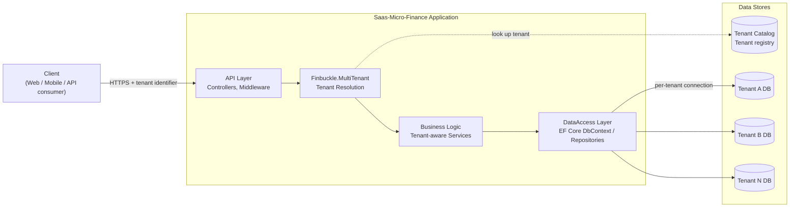
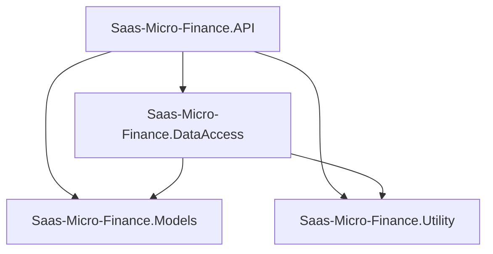
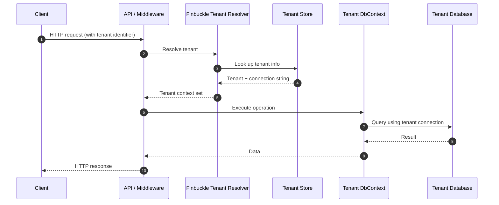
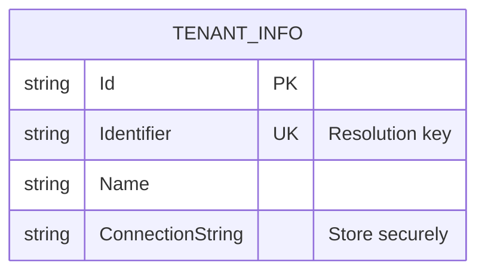
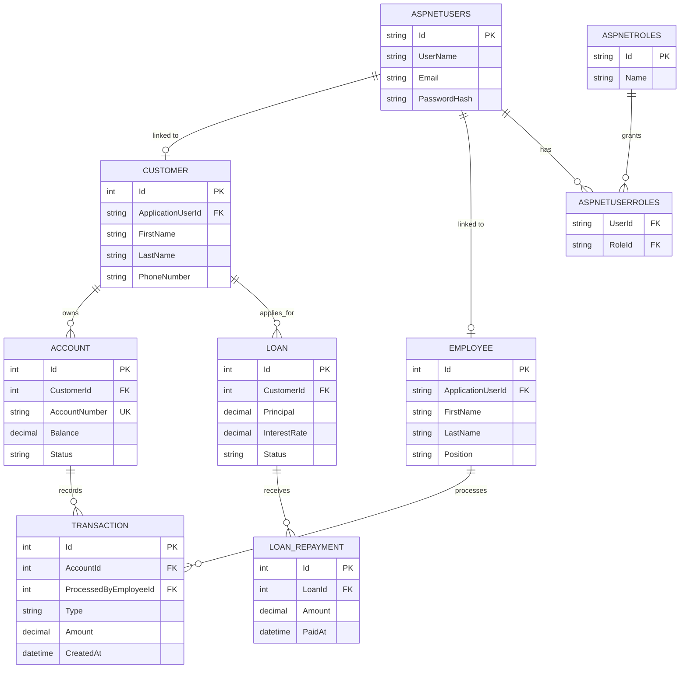

<div align="center">

# SaaS Micro Finance Platform

**A multi-tenant microfinance banking backend built with ASP.NET Core, EF Core, SQL Server and Finbuckle.MultiTenant.**


</div>

---

## Table of Contents

1. [Overview](#overview)
2. [Key Features](#key-features)
3. [Technology Stack](#technology-stack)
4. [System Architecture](#system-architecture)
5. [Multi-Tenancy Design](#multi-tenancy-design)
6. [Project Structure](#project-structure)
7. [Database Design](#database-design)
8. [Getting Started](#getting-started)
9. [Configuration](#configuration)
10. [Testing](#testing)
11. [Security Considerations](#security-considerations)
12. [Roadmap](#roadmap)
13. [Contributing](#contributing)
14. [Author](#author)

---

## Overview

The **SaaS Micro Finance Platform** is a backend system that lets multiple microfinance institutions run on one shared application while keeping each institution's data isolated.

Each institution (a *tenant*) gets its own database. Incoming requests are matched to a tenant, and all data access for that request is routed to that tenant's database. Finbuckle.MultiTenant handles tenant resolution and tenant-aware configuration.

The project prioritises:

- **Tenant isolation:** database-per-tenant separation of operational and financial data.
- **Maintainability:** a layered solution with clear responsibilities per project.
- **Extensibility:** a foundation that can grow to cover core microfinance workflows.

> **Project status:** In progress. The backend foundation is established; testing and the frontend are still to be completed.

---

## Key Features

| Area | Description |
|---|---|
| Multi-tenancy | Tenant resolution and tenant-aware services via Finbuckle.MultiTenant |
| Data isolation | Database-per-tenant persistence |
| Identity & access | ASP.NET Core Identity with per-tenant users and roles |
| Domain model | Tenant-scoped entities such as customers and employees, linked to application users |
| API | RESTful ASP.NET Core Web API |
| Data access | Entity Framework Core with SQL Server |

> Feature coverage will be extended as each module is verified. See the [Roadmap](#roadmap).

---

## Technology Stack

| Layer | Technology |
|---|---|
| Language | C# |
| Framework | ASP.NET Core Web API (.NET 8) |
| ORM | Entity Framework Core |
| Database | Microsoft SQL Server |
| Multi-tenancy | Finbuckle.MultiTenant |
| Authentication | ASP.NET Core Identity |
| IDE | Visual Studio |

---

## System Architecture

### High-level view



### Layered project dependencies



> The arrows show the intended direction of dependency (outer layers depend on inner ones). Adjust to match the project references in the `.csproj` files.

---

## Multi-Tenancy Design

The platform uses a **database-per-tenant** model.

### Request flow



### Isolation model

| Concern | Approach |
|---|---|
| Data storage | Each tenant has its own SQL Server database |
| Tenant resolution | Configured Finbuckle strategy (for example host, header, route or claim) |
| Identity | Users and roles are provisioned **per tenant** |
| Configuration | Tenant-specific settings come from the tenant store |

> Confirm the exact tenant-resolution strategy, provisioning flow and isolation guarantees against the implementation before any production deployment.

---

## Project Structure

```text
Saas-Micro-Finance/
├── Saas-Micro-Finance.sln
├── README.md
├── .gitignore
│
├── Saas-Micro-Finance.API/            # HTTP API and application entry point
│   ├── Controllers/                   # API endpoints
│   ├── Program.cs                     # Startup, DI, Finbuckle and Identity setup
│   ├── appsettings.json               # Non-secret configuration
│   └── ...
│
├── Saas-Micro-Finance.DataAccess/     # Persistence concerns
│   ├── Data/                          # DbContext(s)
│   ├── Migrations/                    # EF Core migrations
│   ├── Repository/                    # Repositories / data access abstractions
│   └── ...
│
├── Saas-Micro-Finance.Models/         # Domain and application models
│   ├── Entities/                      # Persistent entities
│   ├── DTOs/                          # Request / response models
│   └── ...
│
└── Saas-Micro-Finance.Utility/        # Shared helpers and constants
```

> The four top-level projects match the solution. The sub-folders are indicative; update them to mirror what is in the repository.

| Project | Responsibility |
|---|---|
| `Saas-Micro-Finance.API` | Controllers, middleware, startup and dependency injection |
| `Saas-Micro-Finance.DataAccess` | EF Core contexts, migrations and data access |
| `Saas-Micro-Finance.Models` | Entities and related types shared across layers |
| `Saas-Micro-Finance.Utility` | Cross-cutting helpers and constants |

---

## Database Design

The platform separates data into two kinds of store.

1. **Tenant catalog:** the registry of tenants and their connection information.
2. **Tenant databases:** one database per institution, holding Identity and business data.

### Tenant catalog



### Tenant database (illustrative)

The diagram below shows the intended shape of a tenant database: ASP.NET Identity tables linked to the domain entities. Core microfinance entities (accounts, loans, transactions) are shown as the planned domain. **Align entity and column names with your actual models before publishing.**



### Design notes

- **Identity linkage:** creating a customer or employee should also create the corresponding `ApplicationUser` (via `UserManager`) in a single transaction, so every domain record has a login identity.
- **Role seeding:** Identity roles must be seeded in **each tenant database**, not just once globally.
- **Money values:** monetary columns use `decimal` with explicit precision to avoid rounding errors.

---

## Getting Started

### Prerequisites

- [.NET 8 SDK](https://dotnet.microsoft.com/download/dotnet/8.0)
- [Visual Studio](https://visualstudio.microsoft.com/) with the **ASP.NET and web development** workload
- Microsoft SQL Server (local instance or container)
- Git

### Installation

```bash
# 1. Clone the repository
git clone https://github.com/collarfil/Saas-Micro-Finance.git
cd Saas-Micro-Finance

# 2. Restore dependencies
dotnet restore Saas-Micro-Finance.sln

# 3. Build the solution
dotnet build Saas-Micro-Finance.sln
```

### Database setup

> Replace the placeholders below with the actual DbContext names and startup project once confirmed.

```bash
# Apply migrations (example)
dotnet ef database update \
  --project Saas-Micro-Finance.DataAccess \
  --startup-project Saas-Micro-Finance.API
```

Then register at least one tenant in the tenant store so requests can be resolved.

### Run the API

```bash
dotnet run --project Saas-Micro-Finance.API
```

---

## Configuration

Configuration is read from `appsettings.json`, environment variables and (in development) .NET User Secrets.

| Setting | Purpose |
|---|---|
| Tenant store connection string | Location of the tenant catalog |
| Tenant connection strings | One per tenant database |
| Identity options | Password and lockout policy |
| JWT / auth settings | Token issuer, audience and signing key (if applicable) |

Use User Secrets locally:

```bash
cd Saas-Micro-Finance.API
dotnet user-secrets init
dotnet user-secrets set "ConnectionStrings:DefaultConnection" "<your-connection-string>"
```

> **Never commit** passwords, connection strings, API keys or signing keys to source control.

---

## Testing

Automated tests are part of the roadmap. This section will be updated with verified scenarios, including:

- Tenant resolution
- Tenant database selection
- Cross-tenant data isolation
- Identity provisioning and role assignment
- API behaviour and business workflows

```bash
dotnet test Saas-Micro-Finance.sln
```

Only tests that exist and pass will be reported here.

---

## Security Considerations

- Keep credentials and connection strings out of source control.
- Protect endpoints with authentication and authorisation, and enforce role-based access.
- Verify that one tenant can never read or write another tenant's data.
- Store tenant connection strings securely (secret manager or key vault in production).
- Use HTTPS everywhere and validate all input.
- Use synthetic data only in demos; never real customer or financial information.

---

## Roadmap

- [x] Solution structure and layered projects
- [x] Finbuckle.MultiTenant integration
- [x] EF Core and SQL Server persistence
- [ ] Complete and validate automated tests
- [ ] Verify tenant resolution and isolation behaviour
- [ ] Finish the frontend
- [ ] Document API endpoints (OpenAPI / Swagger)
- [ ] Tenant provisioning workflow
- [ ] Core microfinance modules (accounts, savings, loans, repayments)
- [ ] CI pipeline (build and test on every push)
- [ ] Containerisation (Docker) and deployment guide
- [ ] Screenshots and demo video

---

## Contributing

Contributions and suggestions are welcome.

1. Fork the repository
2. Create a feature branch: `git checkout -b feature/your-feature`
3. Commit your changes: `git commit -m "Add your feature"`
4. Push the branch: `git push origin feature/your-feature`
5. Open a Pull Request

---

## License

Add a license (for example MIT) by including a `LICENSE` file, then reference it here.

---

## Author

**Collins Aigbekhai**
GitHub: [@collarfil](https://github.com/collarfil)